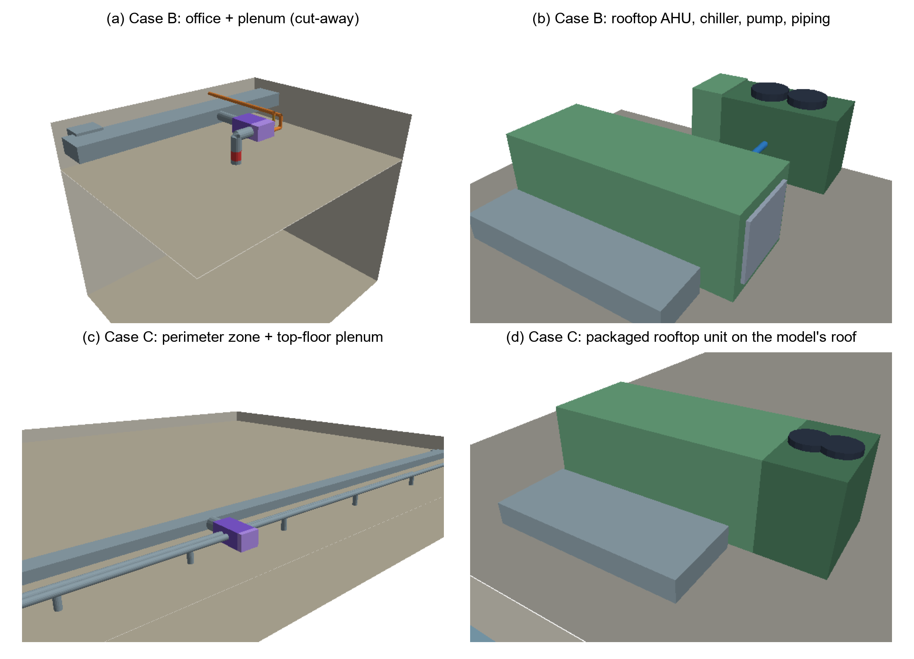
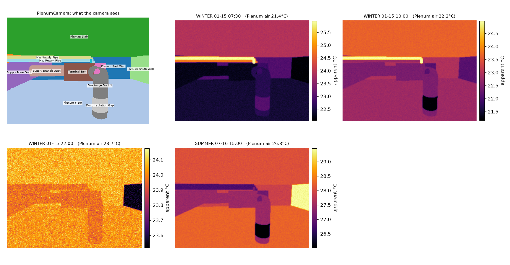

# thermoscene

**Labelled thermal environments for embodied inspection agents (robots, drones, crawlers), generated from building
energy models.**

`thermoscene` turns an ordinary EnergyPlus model into a 3D scene in which every visible surface (walls, windows,
ceilings, diffusers, ducts, pipes, valves, air-handling units, chillers, roofs, occupants, luminaires, workstations)
carries a simulated or physically derived, time-varying temperature, and into an environment an agent can act in:
observe from any pose at any simulated time through a realistic thermal-camera model, with per-pixel labels (true
temperature, instance, category, provenance, depth, emissivity, fault mask); a Gymnasium-style inspection
environment; and a COCO-style dataset exporter. Every quantity states where it comes from: `simulated`, `physics`,
`engineering_rule`, `heuristic`, `assumed_layout` or `user`.



You name a zone; the pipeline

1. **adapts and simulates** your model (output requests, run periods and injected faults are added to a copy; runs are cached),
2. **reads** the zone geometry in world coordinates, the plenum above it and the roof,
3. **traces the HVAC system serving the zone** from the model's node graph, without assuming any object or node names,
4. **generates** what EnergyPlus does not contain (diffusers, plenum ducts and piping, terminal boxes, rooftop units,
   chillers, pumps, valves), sized from EnergyPlus autosizing and bound to simulated nodes,
5. **assigns temperatures** (simulated surfaces; conduction, stagnation, sol-air and heat-rejection models for elements),
6. **writes** an OpenUSD stage, an RDF graph aligned with Brick / ASHRAE 223P and a JSON summary, and renders thermal
   images with per-pixel ground truth, camera readings and provenance.

Documentation: [ontology](docs/ontology.md) · [configuration](docs/configuration.md) ·
[reproducing the paper](docs/reproducing.md) · every assumption: [`thermoscene/defaults.yaml`](thermoscene/defaults.yaml)

## Install

```bash
bash scripts/setup.sh                    # venv, dependencies, EnergyPlus check, case studies, tests
# or by hand:
pip install -r requirements.txt          # or: pip install -e .
export THERMOSCENE_ENERGYPLUS=/path/to/EnergyPlus/energyplus   # EnergyPlus >= 9.6 (tested: 22.2)
```

The hand-made case models (A, B) declare `Version, 22.2;`. With another EnergyPlus version, change that line (the
objects they use are the same in 22.2 and 25.2) or convert them with EnergyPlus's `IDFVersionUpdater`.

## Quick start

```bash
python -m thermoscene inspect path/to/model.idf                       # zones, plenums, traced HVAC per zone
python -m thermoscene inspect path/to/model.idf --zone "Perimeter_top_ZN_1"
python -m thermoscene build case_studies/C_doe_medium_office/case.yaml --render
python -m thermoscene auto path/to/model.idf --render                 # any model, no case file (writes auto_case.yaml)
python -m thermoscene render case_studies/C_doe_medium_office/output/C_doe_medium_office.usda
python -m thermoscene web case_studies/B_hvac_system/output/B_hvac_system.usda -o viewer.html   # real-time browser viewer
~/isaacsim/python.sh thermoscene/isaac/thermal_camera.py case_studies/C_doe_medium_office/output/C_doe_medium_office.usda
```

### Embodied interface (agents, realistic cameras, datasets)

```python
from thermoscene.embodied import ThermalWorld, ThermalCamera, Pose
from thermoscene.embodied.env import InspectionEnv

world = ThermalWorld("case_studies/B_hvac_system/output/B_hvac_system.usda")
cam = ThermalCamera.preset("handheld_320", seed=3)        # or lepton35, drone_640; .randomized(rng) for new units
frame = world.observe(Pose.look_at([2.5, 2.0, 1.6], [2.5, 0.0, 1.2]), world.time_index("WINTER 07:00"), cam)
frame.reading, frame.true, frame.instance, frame.provenance, frame.depth, frame.fault

env = InspectionEnv(world, camera="lepton35", space="Plenum", task="fault_search")
obs, info = env.reset(seed=0)
obs, reward, terminated, truncated, info = env.step(env.action_space.sample())
```

```bash
python -m thermoscene dataset <scene.usda> -o data/ --views 500          # COCO-style labelled dataset
python -m thermoscene episode <scene.usda> -o frames/ --space Plenum        # one random-agent episode, saved frames
```

The camera model (distortion, diffraction and lens blur, non-uniformity, column/row offsets, shading, drift between
shutter corrections, NETD noise, calibration error, dead pixels, quantisation, 8-bit AGC) and the scene realism
(directional emissivity, specular reflections, within-surface variation, occupants/luminaires/workstations from the
simulated schedules) are described in [docs/embodied.md](docs/embodied.md); every value and its source is in
[docs/sensors.md](docs/sensors.md). The rasteriser reproduces the reference ray caster pixel for pixel, 10-60 times faster.

### Learning in the environments (virtual training)

A U-Net void detector trained only on scenes generated from 45 EnergyPlus example buildings found 79 % of the
insulation voids in 23 buildings it had never seen (instance F1 0.51 on realistic camera readings). The same network
trained on the true temperature fields or on idealised images of the same views found almost none (F1 0.04 and 0.02).
In the inspection environment of an unseen office, the agent steered by the realistic-trained detector found the void in
17 of 30 episodes, against 6 and 5 for the other two detectors and 4 for random actions
([docs/detector.md](docs/detector.md), [docs/env_baselines.md](docs/env_baselines.md)). Learning needs PyTorch
(`pip install -r requirements-learning.txt`):

```bash
python case_studies/detector_data.py all --jobs 5       # after corpus_survey.py: void scenes, 40 views per building
python case_studies/detector_train.py --epochs 15 --seeds 3
python case_studies/env_baselines.py                    # agents in cases B and C; --perception adds the aimed-view check
```

### Real-time viewer in the browser

`thermoscene web` packs a scene into one self-contained HTML file (ready-made: [`docs/viewer/`](docs/viewer)). Open it in
any WebGL2 browser: move the camera freely (orbit, pan, zoom, or jump to the scene's camera presets), scrub or play the
simulated period, and switch between the simulated camera reading, the true surface temperature, the provenance of each
value and the generated geometry. A spot meter at the centre and a hover readout show actual and camera temperatures;
emissivity and reflected-temperature settings of the camera can be changed live. The per-pixel radiometry runs in a GPU
shader and agrees with the Python reference renderer to within 1e-3 K (1e-4 K between 10 and 70 °C). Because the free
camera belongs to no single space, each surface reflects the mean radiant temperature of its own space, and optical blur
is omitted.

## Use your own model

```yaml
name: my_building
model: {idf: my_model.idf, epw: my_weather.epw}
energyplus:
  run_periods: [{name: SUMMER, start: "07-15", end: "07-16"}, {name: WINTER, start: "01-14", end: "01-15"}]
scene:
  zone: "Office_3F_East"          # from `thermoscene inspect`
  plenum: auto
  roof: {source: model}           # the model's roof surfaces (top floor), or `box`, or `none`
faults:
  - {type: envelope_defect, surface: "Office_3F_East_Wall_South", rect: [2.0, 3.0, 0.3, 1.1]}
cameras:
  - {name: Overview, space: zone, auto: {target: Window}, frames: ["WINTER 08:00", "SUMMER 15:00"]}
```

Everything else falls back to `defaults.yaml`. Your model file is never modified.

## Case studies

| Case | Model | Shows |
|---|---|---|
| [A_single_room](case_studies/A_single_room) | single office, packaged rooftop VAV (DX) with electric reheat, no plenum | packaged unit generated from a traced DX coil; injected envelope defect |
| [B_hvac_system](case_studies/B_hvac_system) | same office + return plenum, central chilled-water VAV (AHU, air-cooled chiller, boiler, hot-water reheat) | complete distribution and plant; duct-insulation fault (paper case study B) |
| [C_doe_medium_office](case_studies/C_doe_medium_office) | **unmodified** DOE reference medium office shipped with EnergyPlus | only the zone is named; automatic cameras; real roof; sidecar storage (paper case study C) |

| Case | EnergyPlus surfaces | Generated elements | Traced components | Element/surface temperatures: simulated / physics / heuristic |
|---|---|---|---|---|
| A | 8 | 12 | 8 | 8 / 0 / 12 |
| B | 14 | 28 | 17 | 14 / 11 / 17 |
| C | 26 | 37 | 10 | 26 / 14 / 23 |



## Evaluation

* **Topology correctness** ([docs/topology_survey.md](docs/topology_survey.md)): 12 EnergyPlus example models, 8 HVAC
  system types, **180 of 180 conditioned zones traced** without configuration. Compared component by component with the
  chain declared by each model's own system objects: **precision 1.000, recall 1.000**, 180 of 180 chains identical
  (every item of a zone's equipment list, zone exhaust fans included, belongs to its chain).
* **Every EnergyPlus example file** ([docs/corpus_survey.md](docs/corpus_survey.md), `case_studies/corpus_survey.py`):
  the tracer on all 719 `ExampleFiles` of EnergyPlus 22.2 (no simulation): **4,088 of 4,088 conditioned zones traced**,
  precision 0.993, recall 1.000; and `thermoscene auto` (simulation, scene, rendering) on each of them: **677 of 685
  in-scope models built and rendered**, i.e. every model EnergyPlus 22.2 runs as shipped, with a failure taxonomy.
* **Whole-building robustness** ([docs/zone_sweep.md](docs/zone_sweep.md)): scenes for **all 15 conditioned zones** of the
  unmodified DOE reference medium office, 2–7 s each on a laptop CPU with one shared simulation.
* **Benchmarks** ([docs/benchmark.md](docs/benchmark.md)): the physics-level element models agree with an independent
  natural-convection and radiation calculation within 0.5 K (insulated pipe), 0.9 K (wrapped duct) and 1.1 K (bare
  duct); a 2-D conduction section reproduces the 1-D envelope-void contrast to 0.01 K.
* **Global sensitivity** ([docs/morris.md](docs/morris.md), [docs/sensitivity.md](docs/sensitivity.md)): Morris screening
  and one-at-a-time variation of 14 non-simulated parameters on 8 apparent contrasts of case B.
* **Faults over a year** ([docs/annual.md](docs/annual.md)): the duct-insulation gap of case B is visible (≥ 1 K) in 97 %
  of the time steps with air flow but adds 1 % to the office's sensible cooling; the envelope void raises its wall's
  annual conduction by about a fifth while its contrast changes sign on most days.
* **Per-frame provenance**: every rendered frame has a provenance map; ceiling pixels count as heuristic only where the
  jet model changes them by at least 0.1 K, and elements whose fluid is stagnant count as heuristic at those steps.
* **Renderer agreement and sanity** (`tests/`): the Isaac Sim shading path reproduces the reference renderer to < 1e-4 K
  for every camera of every case (last preview frame); no missing or implausible temperatures.
* **Numbers quoted in the paper's text** ([docs/paper_numbers.md](docs/paper_numbers.md)): every temperature, size,
  provenance share, run time and file size in Sections 5.1–5.7, computed from the built cases by
  `case_studies/paper_numbers.py`. CI rebuilds the cases with EnergyPlus 22.2 on Linux and compares these numbers with
  the committed ones.

## Limitations

Scenes are replay-only: thermal states are precomputed and do not respond to robot actions. Layout is a replaceable
rule set (orthogonal routing in one plenum, no clash avoidance, rooftop units in a row). Heuristic models (equipment
casings, motors, condensers, diffuser faces, ceiling jets) are uncalibrated; their parameters are centralised in
`defaults.yaml`. One temperature per EnergyPlus surface; reflections approximated by one reflected temperature per
space. Coupling is one-way: heat exchanged by generated elements is not returned to EnergyPlus (for the duct gap of
case B it is 1 % of the zone's cooling). No image has yet been compared with field thermography. The Isaac Sim rendering calls follow the documented 4.5–6.x API and were not executed by the authors (no GPU);
the shading path they feed is tested.

## Repository layout

```
thermoscene/               package
  ontology.py              concepts, relations, provenance, Brick/223P mapping, scene graph, RDF export
  defaults.yaml            sizing and layout rules, materials, thermal-model and camera parameters
  energyplus/              idf_text, runner, model (geometry), results (SQLite), topology (generic tracer)
  scene/                   spaces, geometry, faults
  generators/              air_devices, distribution (plenum), equipment (roof / plant)
  thermal/                 radiometry, environment (sun, sky), models (registry)
  usd/writer.py            OpenUSD output (time samples or NPZ sidecar)
  render/                  shading (shared), raycast (reference renderer, provenance maps), cameras
  isaac/thermal_camera.py  Isaac Sim thermal cameras
  web/                     export.py + viewer.html: self-contained real-time thermal viewer
case_studies/              A, B, C (model + case.yaml), weather, topology_survey.py, zone_sweep.py,
                           sensitivity.py, morris.py, benchmark.py, annual.py, paper_numbers.py,
                           compare_numbers.py, paper_figures.py, *.json results
docs/                      ontology, configuration, reproducing, survey / sweep / sensitivity / Morris /
                           benchmark / annual tables, paper numbers, paper figures, viewers
scripts/                   setup.sh / setup.ps1: one-command local setup
paper/                     manuscript (Energy and Buildings format), supplementary, cover letter, references
tests/                     test_core.py
.github/workflows/ci.yml   unit tests + lint; EnergyPlus 22.2 pipeline job reproducing the paper numbers
```

## Citation

See [CITATION.cff](CITATION.cff). Licence: [MIT](LICENSE).
