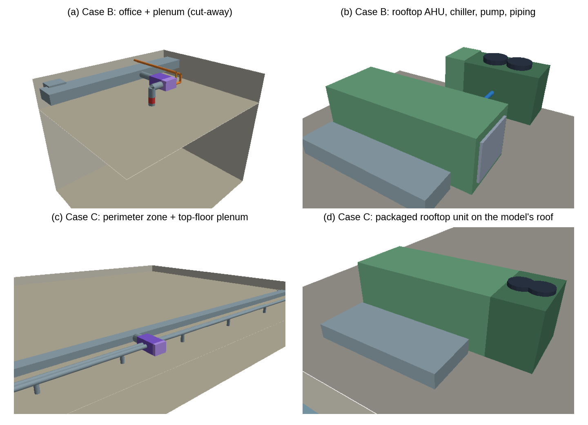
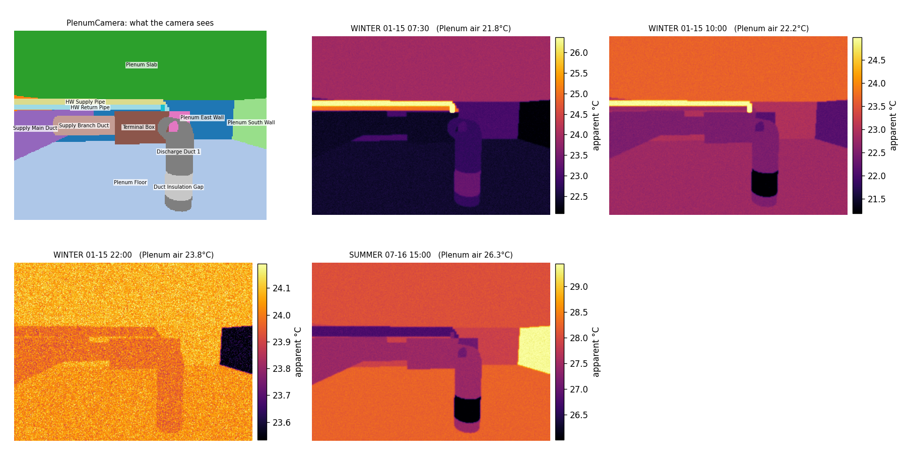

# thermoscene

**Virtual thermal training environments for robots and drones, generated from building energy models.**

`thermoscene` turns an ordinary EnergyPlus model into a 3D scene in which every visible surface (walls, windows,
ceilings, diffusers, ducts, pipes, valves, air-handling units, chillers, roofs) carries a simulated or physically derived,
time-varying temperature, ready for thermal-camera simulation in Isaac Sim (OpenUSD), in the browser, or with the bundled
CPU renderer. Every quantity states where it comes from: `simulated`, `physics`, `engineering_rule`, `heuristic`,
`assumed_layout` or `user`.



You name a zone; the pipeline

1. **adapts and simulates** your model (output requests, run periods and injected faults are added to a copy; runs are cached),
2. **reads** the zone geometry in world coordinates, the plenum above it and the roof,
3. **traces the HVAC system serving the zone** from the model's node graph, without assuming any object or node names,
4. **generates** what EnergyPlus does not contain (diffusers, plenum ducts and piping, terminal boxes, rooftop units,
   chillers, pumps, valves), sized from EnergyPlus autosizing and bound to simulated nodes,
5. **assigns temperatures** (simulated surfaces; conduction, stagnation, sol-air and heat-rejection models for elements),
6. **writes** an OpenUSD stage, an RDF graph aligned with Brick / ASHRAE 223P and a JSON summary, and renders thermal
   images with per-pixel ground truth, camera readings and provenance.

Documentation: [ontology](docs/ontology.md) · [configuration](docs/configuration.md) ·
[reproducing the paper](docs/reproducing.md) · every assumption: [`thermoscene/defaults.yaml`](thermoscene/defaults.yaml)

## Install

```bash
bash scripts/setup.sh                    # venv, dependencies, EnergyPlus check, case studies, tests
# or by hand:
pip install -r requirements.txt          # or: pip install -e .
export THERMOSCENE_ENERGYPLUS=/path/to/EnergyPlus-25.2/energyplus   # EnergyPlus >= 9.6 (tested: 25.2)
```

## Quick start

```bash
python -m thermoscene inspect path/to/model.idf                       # zones, plenums, traced HVAC per zone
python -m thermoscene inspect path/to/model.idf --zone "Perimeter_top_ZN_1"
python -m thermoscene build case_studies/C_doe_medium_office/case.yaml --render
python -m thermoscene render case_studies/C_doe_medium_office/output/C_doe_medium_office.usda
python -m thermoscene web case_studies/B_hvac_system/output/B_hvac_system.usda -o viewer.html   # real-time browser viewer
~/isaacsim/python.sh thermoscene/isaac/thermal_camera.py case_studies/C_doe_medium_office/output/C_doe_medium_office.usda
```

### Real-time viewer in the browser

`thermoscene web` packs a scene into one self-contained HTML file (ready-made: [`docs/viewer/`](docs/viewer)). Open it in
any WebGL2 browser: move the camera freely (orbit, pan, zoom, or jump to the scene's camera presets), scrub or play the
simulated period, and switch between the simulated camera reading, the true surface temperature, the provenance of each
value and the generated geometry. A spot meter at the centre and a hover readout show actual and camera temperatures;
emissivity and reflected-temperature settings of the camera can be changed live. The per-pixel radiometry runs in a GPU
shader and matches the Python reference renderer to 1e-4 K.

## Use your own model

```yaml
name: my_building
model: {idf: my_model.idf, epw: my_weather.epw}
energyplus:
  run_periods: [{name: SUMMER, start: "07-15", end: "07-16"}, {name: WINTER, start: "01-14", end: "01-15"}]
scene:
  zone: "Office_3F_East"          # from `thermoscene inspect`
  plenum: auto
  roof: {source: model}           # the model's roof surfaces (top floor), or `box`, or `none`
faults:
  - {type: envelope_defect, surface: "Office_3F_East_Wall_South", rect: [2.0, 3.0, 0.3, 1.1]}
cameras:
  - {name: Overview, space: zone, auto: {target: Window}, frames: ["WINTER 08:00", "SUMMER 15:00"]}
```

Everything else falls back to `defaults.yaml`. Your model file is never modified.

## Case studies

| Case | Model | Shows |
|---|---|---|
| [A_single_room](case_studies/A_single_room) | single office, packaged rooftop VAV (DX) with electric reheat, no plenum | packaged unit generated from a traced DX coil; injected envelope defect |
| [B_hvac_system](case_studies/B_hvac_system) | same office + return plenum, central chilled-water VAV (AHU, air-cooled chiller, boiler, hot-water reheat) | complete distribution and plant; duct-insulation fault (paper case study B) |
| [C_doe_medium_office](case_studies/C_doe_medium_office) | **unmodified** DOE reference medium office shipped with EnergyPlus | only the zone is named; automatic cameras; real roof; sidecar storage (paper case study C) |

| Case | EnergyPlus surfaces | Generated elements | Traced components | Element/surface temperatures: simulated / physics / heuristic |
|---|---|---|---|---|
| A | 8 | 12 | 8 | 8 / 0 / 12 |
| B | 14 | 28 | 17 | 14 / 14 / 14 |
| C | 26 | 37 | 10 | 26 / 14 / 23 |



## Evaluation

* **Topology generality** ([docs/topology_survey.md](docs/topology_survey.md)): 12 EnergyPlus example models, 8 HVAC
  system types, **180 of 180 conditioned zones traced** without configuration.
* **Whole-building robustness** ([docs/zone_sweep.md](docs/zone_sweep.md)): scenes for **all 15 conditioned zones** of the
  unmodified DOE reference medium office, 1.2–9 s each with one shared simulation.
* **Sensitivity** ([docs/sensitivity.md](docs/sensitivity.md)): one-at-a-time variation of 7 non-simulated parameters;
  each acts only on the elements it governs.
* **Renderer agreement and sanity** (`tests/`): the Isaac Sim shading path reproduces the reference renderer to < 1e-4 K
  for every camera of every case; no missing or implausible temperatures.

## Limitations

Scenes are replay-only: thermal states are precomputed and do not respond to robot actions. Layout is a replaceable
rule set (orthogonal routing in one plenum, no clash avoidance, rooftop units in a row). Heuristic models (equipment
casings, motors, condensers, diffuser faces, ceiling jets) are uncalibrated; their parameters are centralised in
`defaults.yaml`. One temperature per EnergyPlus surface; reflections approximated by one reflected temperature per
space. The Isaac Sim rendering calls follow the documented 4.5–6.x API and were not executed by the authors (no GPU);
the shading path they feed is tested.

## Repository layout

```
thermoscene/               package
  ontology.py              concepts, relations, provenance, Brick/223P mapping, scene graph, RDF export
  defaults.yaml            every rule, assumption and parameter
  energyplus/              idf_text, runner, model (geometry), results (SQLite), topology (generic tracer)
  scene/                   spaces, geometry, faults
  generators/              air_devices, distribution (plenum), equipment (roof / plant)
  thermal/                 radiometry, environment (sun, sky), models (registry)
  usd/writer.py            OpenUSD output (time samples or NPZ sidecar)
  render/                  shading (shared), raycast (reference renderer, provenance maps), cameras
  isaac/thermal_camera.py  Isaac Sim thermal cameras
  web/                     export.py + viewer.html: self-contained real-time thermal viewer
case_studies/              A, B, C (model + case.yaml), weather, topology_survey.py, zone_sweep.py,
                           sensitivity.py, paper_figures.py, zone_sweep.json, sensitivity.json
docs/                      ontology, configuration, reproducing, survey / sweep / sensitivity tables,
                           paper figures, viewers
scripts/                   setup.sh / setup.ps1: one-command local setup
paper/                     manuscript (export from the draft document)
tests/                     test_core.py
```

## Citation

See [CITATION.cff](CITATION.cff). Licence: [MIT](LICENSE).
