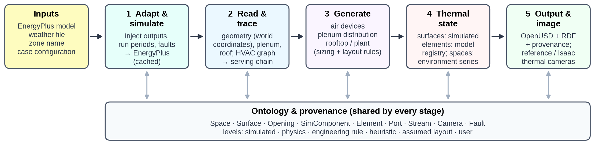
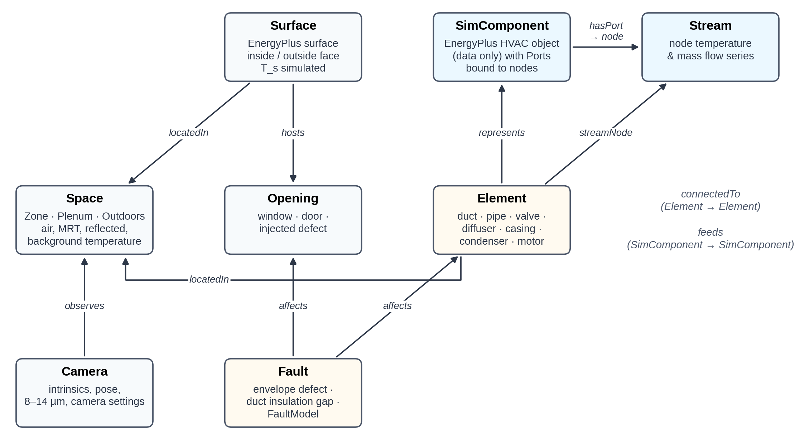
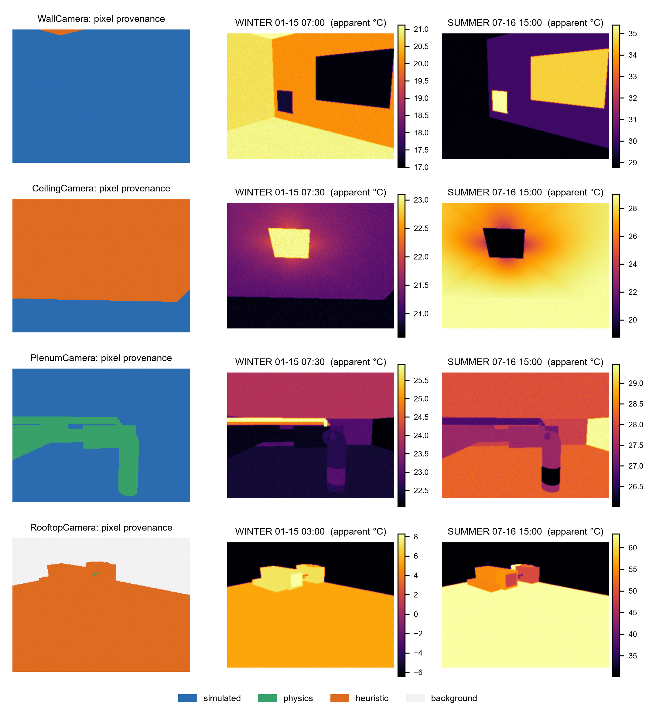
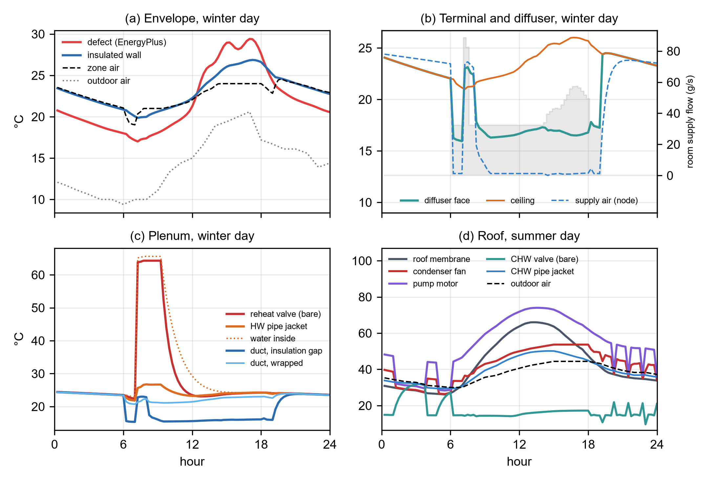
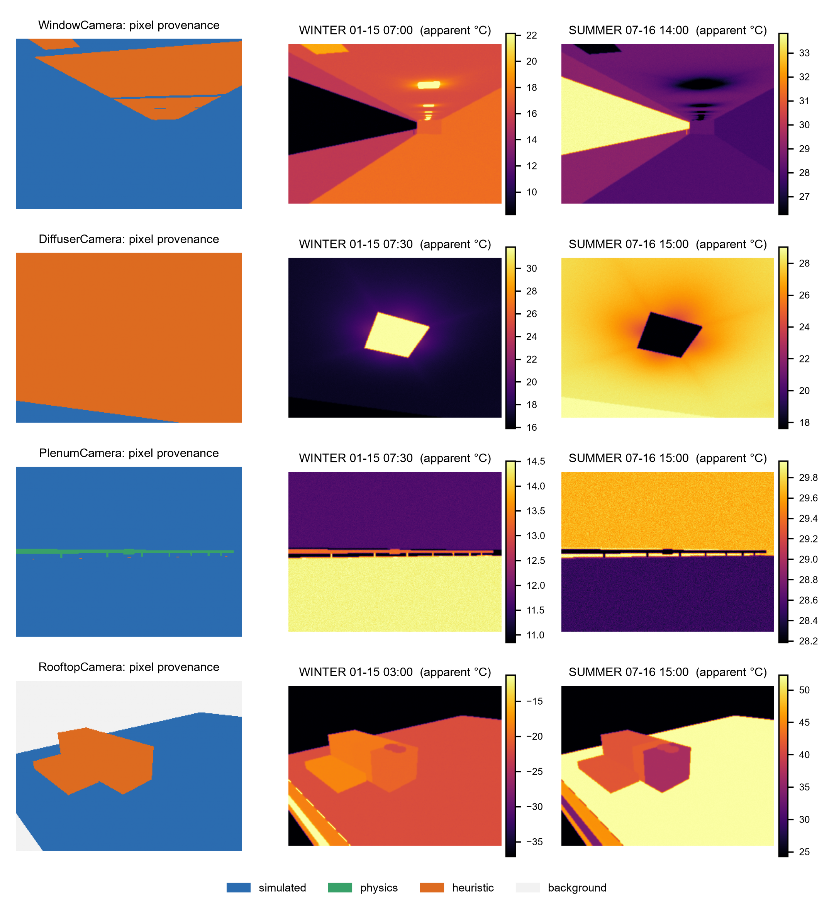
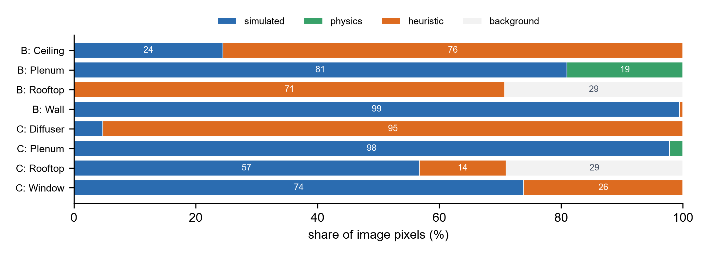

# Highlights {-}

- EnergyPlus models become 3D thermal scenes of envelopes and HVAC systems
- Name-free topology tracing recovered HVAC chains for 180 of 180 zones
- Ducts, pipes and plant are generated from autosizing, tied to simulated nodes
- Per-pixel provenance shows which image temperatures are simulated or assumed
- Runs unchanged on an unmodified US reference office building, all 15 zones

# Abstract {-}

Ground robots and drones that inspect buildings increasingly carry thermal cameras, but no virtual training environment provides scenes whose surface temperatures follow from building and heating, ventilation and air-conditioning (HVAC) operation. Building energy models compute these temperatures but contain no HVAC geometry and are not scenes. This paper presents thermoscene, an open pipeline that turns an existing EnergyPlus model into a three-dimensional thermal scene of a chosen zone, its envelope and the HVAC system serving it, for training and testing robot thermal perception in simulation. An ontology separates simulated components from generated physical elements and attaches one of six provenance levels to every quantity. A name-free tracer recovers the equipment serving the zone from the model's node graph. Generators add diffusers, ducts, piping, terminal boxes, air-handling units and chillers, sized from EnergyPlus autosizing and bound to simulated nodes, so their surface temperatures follow simulated fluid conditions through conduction, stagnation, sol-air and heat-rejection models. Envelope and duct-insulation faults are injected so their signatures are computed, not drawn. Scenes are written as OpenUSD with per-pixel ground truth, simulated camera readings and pixel provenance. Topology tracing succeeded for all 180 conditioned zones of twelve EnergyPlus example models covering eight system types, and full scenes were built for every zone of an unmodified U.S. Department of Energy reference office. Envelope and plenum views were almost entirely simulated or physics-derived, whereas ceiling and rooftop views relied on heuristics. The detectability of a duct-insulation fault depended more on facing emissivity than on thermal parameters.

# Introduction {#sec:s1}

Mobile robots and drones are entering buildings as inspectors, cleaners, couriers and assistants, and many carry long-wave infrared (thermal) cameras; drones already fly thermographic surveys of roofs and façades, and small crawlers and drones can reach ceiling plenums that people inspect only rarely. In buildings, thermal imaging is the standard tool for finding missing insulation, air leakage, moisture, failing valves, overheated electrical and mechanical equipment and malfunctioning terminal units [@kylili2014infrared; @fox2014thermography; @lucchi2018applications]. A robot or drone that can read these signatures could turn periodic manual thermography into continuous, autonomous building diagnostics [@halder2023robots].

Learning such skills requires virtual training and test environments in which every visible surface has a temperature that is physically consistent with the building, its systems and the weather. Existing simulation environments for embodied AI provide geometry, appearance and rigid-body physics at scale, from reconstructed homes to procedurally generated interiors [@savva2019habitat; @ramakrishnan2021hm3d; @deitke2022procthor; @raistrick2024infinigen]. None of them carries thermal state. Their scenes have no heating, ventilation and air-conditioning (HVAC) systems, no ducts or pipes behind the ceiling, and no relation between what a camera sees and how the building operates.

Building energy simulation has the opposite profile. Engines such as EnergyPlus [@crawley2001energyplus] compute validated, time-resolved surface temperatures, zone conditions and the temperatures and flows at every node of the HVAC system, and national model collections cover entire building stocks [@new2021modelamerica]. These models, however, are not scenes. Thermal zones are coarse shells, HVAC equipment exists only as a node graph without dimensions or location, and nothing a robot would see above a ceiling or on a roof is represented. Semantic building models such as Brick [@balaji2016brick] and ASHRAE 223P [@ashrae2026standard223p] describe system topology but neither geometry nor thermal state, and building information models (BIM) describe geometry but rarely operation [@kamel2019bim].

This paper bridges the two. We present **thermoscene**, an open pipeline that turns an ordinary EnergyPlus model into a three-dimensional thermal scene: an OpenUSD stage in which walls, windows, ceilings, diffusers, ducts, pipes, valves, air-handling units, chillers and roofs each carry a time series of surface temperature, ready for thermal-camera simulation in robotics simulators such as NVIDIA Isaac Sim. The user names a zone; the pipeline reads its geometry, simulates the building, traces the HVAC system that serves the zone, generates the physical elements EnergyPlus does not contain, assigns temperatures to them, and renders thermal images with ground-truth labels.

Three requirements shaped the design. First, the pipeline must work on models it has never seen, without model-specific names or edits; this rules out hand-built mappings from EnergyPlus objects to geometry. Second, every quantity that is not simulated is an assumption, and a user training or evaluating a perception model must be able to tell which is which. Third, the result must be usable directly by robotics tools rather than only by building scientists.

**Scope.** This paper addresses the first layer of a robot training environment: physically grounded thermal scenes and the labelled observations that a thermal camera on a ground robot or drone would record in them, at any pose and any simulated time. The scenes operate in replay mode: thermal states are precomputed from the simulation and do not respond to the robot's actions. Closing that loop, together with navigable multi-room scenes, visual appearance, benchmark tasks and validation against field data, is outside the scope of this paper; @sec:s6-2 sets out what remains between these scenes and a complete robot test environment.

The contributions are:

1. An ontology for thermal scenes of buildings that separates simulated components from generated physical elements, binds each element to the EnergyPlus node whose fluid it carries, and attaches one of six provenance levels to every quantity (simulated, physics, engineering rule, heuristic, assumed layout, user).
2. A generic HVAC topology tracer that builds a component–node graph from any EnergyPlus model and recovers the chain of equipment serving a zone, including plant equipment behind water coils, without assuming object or node names.
3. A rule-based generation and thermal-state layer: air devices, plenum distribution and rooftop equipment sized from EnergyPlus autosizing, with surface temperatures derived from simulated fluid temperatures through conduction, stagnation, sol-air and heat-rejection models, and with envelope and duct-insulation faults injected so that EnergyPlus or the element models compute their thermal signatures.
4. A thermal image formation model in the 8–14 µm band, shared by a CPU reference renderer and an Isaac Sim implementation, producing per-pixel ground-truth temperatures, simulated camera readings and per-pixel provenance.
5. An evaluation on a system-level case (an office served by a central chilled-water variable-air-volume system), on an unmodified U.S. Department of Energy (DOE) reference building, on every zone of that building, and on twelve EnergyPlus example models covering eight HVAC system types.

@sec:s2 reviews related work. @sec:s3 describes the method. @sec:s4 presents the case studies and evaluation design, and @sec:s5 the results. @sec:s6 discusses implications and limitations, and @sec:s7 concludes.

# Related work {#sec:s2}

No existing approach produces robot-ready scenes whose thermal state follows from building and HVAC simulation. @tbl:t1 positions this work against four adjacent lines of research.

## Simulation environments for embodied AI {#sec:s2-1}

Embodied-AI research trains navigation and manipulation policies in simulated indoor scenes. Habitat [@savva2019habitat] and the HM3D dataset [@ramakrishnan2021hm3d] use scanned homes; AI2-THOR and ProcTHOR [@kolve2017ai2thor; @deitke2022procthor] and Infinigen Indoors [@raistrick2024infinigen] generate interiors procedurally; BEHAVIOR [@srivastava2022behavior] adds object states for household tasks; Isaac Sim and its learning framework [@mittal2023orbit] provide GPU physics and sensor simulation on OpenUSD. Generative world models now synthesise scenes from images or text [@nvidia2025cosmos]. These environments model what a space looks like. They contain no HVAC systems, no concealed services and no temperatures. The closest thermal effort is an object-level RGB–thermal–3D dataset for temperature-aware manipulation of household items [@su2026hearth], which addresses objects rather than buildings and their systems.

## Building energy models, BIM and semantic building models {#sec:s2-2}

Whole-building energy simulation computes heat balances of surfaces and zones and the operation of HVAC plants [@crawley2001energyplus]. Reference and prototype buildings [@deru2011reference] and urban-scale model generation such as Model America [@new2021modelamerica] make these models available for whole building stocks. BIM-to-BEM workflows translate geometry from BIM into energy models [@kamel2019bim], the opposite direction to this work. Semantic metadata schemas such as Brick [@balaji2016brick] and ASHRAE 223P describe equipment, points and connections, and time-series datasets organised with Brick support analytics [@prabowo2024building]. Synthetic images rendered from BIM have been used to train segmentation of MEP components [@baubriaud2023mepseg]. None of these couples physical geometry of the HVAC system with its simulated thermal state.

## Simulation environments for building control {#sec:s2-3}

Reinforcement-learning and benchmarking frameworks wrap building simulation as control environments: BOPTEST [@blum2021boptest], Sinergym [@jimenezraboso2021sinergym] and the Smart Buildings Control Suite [@goldfeder2024smart]. Learned dynamics models of indoor environments for HVAC control have also been proposed, including diffusion-based world models [@yang2026adapt]. These environments expose zone-level states and actions to a controller. They have no spatial scene and no observation from an agent's viewpoint.

## Infrared thermography of buildings and synthetic thermal data {#sec:s2-4}

Infrared thermography is established for envelope diagnostics and energy audits [@kylili2014infrared; @fox2014thermography; @lucchi2018applications]. Its interpretation depends on emissivity, reflected apparent temperature and the thermal history of the surface: metallic and foil-faced surfaces reflect their surroundings, and the contrast of a defect depends on weather and time of day [@vollmer2018infrared]. Robotic platforms for building inspection increasingly carry thermal cameras [@halder2023robots]. Training data for automated interpretation remain scarce because faults are rare and labelled thermal images of real equipment are expensive to collect. Synthetic data with domain randomisation is the usual remedy in robotics [@tobin2017domain], but it needs a source of physically plausible temperatures.

Table: Capabilities of related approaches (✓ provided, ◐ partial, – absent). {#tbl:t1}

| Approach | 3D scene for robots | HVAC / MEP geometry | Simulated thermal state | System topology | Provenance of values | Works from existing building models |
| --- | --- | --- | --- | --- | --- | --- |
| Embodied-AI simulators [@savva2019habitat; @deitke2022procthor; @raistrick2024infinigen] | ✓ | – | – | – | – | – |
| Generative world models [@nvidia2025cosmos] | ✓ | – | – | – | – | – |
| Object thermal datasets [@su2026hearth] | ◐ | – | ◐ (measured, objects) | – | – | – |
| Building control environments [@blum2021boptest; @goldfeder2024smart] | – | – | ✓ (zone level) | ◐ | – | ✓ |
| BIM / semantic models [@balaji2016brick; @baubriaud2023mepseg] | ◐ | ✓ (BIM) | – | ✓ | – | ◐ |
| **thermoscene (this work)** | ✓ | ✓ (generated) | ✓ (surface level) | ✓ | ✓ | ✓ |

# Methodology {#sec:s3}

## Overview {#sec:s3-1}

The pipeline has five stages that share one ontology (@fig:f1). Its inputs are an EnergyPlus model in IDF format, a weather file, the name of one zone and a short case configuration in YAML. The configuration is deep-merged over a defaults file that holds the sizing and layout rules, material properties and thermal-model parameters, so that the main assumptions live in one place. The outputs are an OpenUSD stage, an RDF graph of the scene, a JSON summary and, optionally, rendered thermal images.

{#fig:f1 width=6.5in}

## Ontology and provenance {#sec:s3-2}

The ontology distinguishes what EnergyPlus simulates from what the pipeline generates (@fig:f2). A **Space** is a volume with its own thermal environment: a conditioned zone, a plenum or the outdoors. A **Surface** is an EnergyPlus heat-transfer surface; an **Opening** is a sub-surface cut out of it (window, door or injected defect). A **SimComponent** is an EnergyPlus HVAC object, kept as data only, with **Ports** bound to EnergyPlus nodes and a medium (air or water). An **Element** is a visible object generated for the scene, such as a duct segment, pipe, valve, diffuser or equipment casing. Each Element may *represent* one or more SimComponents and, when a fluid flows inside it, carries a *stream node*: the EnergyPlus node of that fluid. A **Stream** is the temperature and mass-flow time series at that node. A **Camera** observes one Space, which supplies the reflected and background temperatures, and a **Fault** affects a Surface or an Element.

{#fig:f2 width=6.5in}

Every quantity of every instance carries one of six provenance levels: *simulated* (computed by EnergyPlus), *physics* (derived from simulated values by a physical model), *engineering rule* (design practice such as design velocities), *heuristic* (an empirical relation with uncalibrated parameters), *assumed layout* (placement chosen by a rule) and *user* (given in the configuration). Levels are written into the USD stage next to each attribute, counted in the summary and exported to RDF. Classes map to Brick [@balaji2016brick] and ASHRAE 223P terms, so the scene graph can be queried with existing building-metadata tools.

## Model adaptation and simulation {#sec:s3-3}

The user's model is never edited in place. A minimal IDF tool copies it, replaces its run periods and time step, and appends what the pipeline needs: output variables requested with wildcard keys (surface inside and outside face temperatures, zone mean air and radiant temperatures, node temperatures and mass flows, equipment part-load ratios, heat-rejection and electricity rates, and site sky temperature, dew point and solar irradiance), an SQLite output, the requested time step and run periods. When run periods are given, weather-file runs are switched on and design-day runs off in SimulationControl, since several reference models ship with the opposite setting. Faults that EnergyPlus must simulate are injected at this point (@sec:s3-6-4).

The prepared model is simulated, with ExpandObjects when it contains HVAC templates. Runs are cached by a SHA-256 hash of the prepared model, the weather file and the EnergyPlus executable, so scenes for many zones of one building share a single simulation; the EnergyPlus version is recorded in every scene. The expanded model is converted to epJSON, whose named fields make the readers independent of field order and EnergyPlus version. Results are read from SQLite on a common time axis that keeps weather-file run periods, drops design days and HVAC sub-steps, and prefers time-step frequency when a variable was also requested hourly by the original model.

## Spaces and surfaces {#sec:s3-4}

The target zone's surfaces are read in world coordinates, honouring GlobalGeometryRules (relative coordinates, zone origins and rotation, clockwise vertex entry). Windows, doors and injected defects become Openings and are cut out of their host as polygon holes before triangulation, so any planar polygon is supported. The plenum is detected through the zone's ceiling: if its boundary condition is another surface and that surface's zone is listed in an AirLoopHVAC:ReturnPlenum or SupplyPlenum, or is named as a plenum, that zone becomes a Plenum space. Coincident interzone faces are each moved 5 mm into their own space so that each side renders its own temperature. Outdoor-facing surfaces can also receive an exterior skin that carries the outside-face temperature and the outside-layer emissivity; inside faces use the thermal absorptance of the innermost layer, which EnergyPlus uses as long-wave emissivity.

## Generic HVAC topology tracing {#sec:s3-5}

The tracer builds a directed graph whose vertices are EnergyPlus nodes, components and zones, and recovers the equipment serving a zone without any object or node names.

1. **Components and ports.** Every object outside an exclusion list (controllers, setpoint and availability managers, sizing, schedules, output and energy-management objects, branch, loop and list containers) whose fields reference nodes becomes a SimComponent. A field is a port if its name contains *node* and *inlet* or *outlet*, which also gives its direction; sensor, set-point, control and reference nodes are ignored. Node lists are expanded, and one override table handles objects whose field names carry no direction (the outdoor-air mixer's *mixed* and *stream* nodes).
2. **Edges.** An inlet port gives an edge node → component; an outlet port, component → node. Components sharing a node are therefore connected.
3. **Implicit links.** Supply and demand sides of AirLoopHVAC, PlantLoop and CondenserLoop are joined node to node, marking demand-to-supply links as return links. Connector:Splitter and Connector:Mixer reference branches rather than nodes, so the last outlet node of each inlet branch is linked to the first inlet node of each outlet branch. Each zone becomes a pseudo-component between its inlet and return nodes (ZoneHVAC:EquipmentConnections).
4. **Medium and role.** Nodes on branches listed by plant or condenser loops carry water; all others carry air. Branch-list membership assigns roles (air supply, plant supply, plant demand, condenser supply or demand), air distribution units mark terminal units, and zone equipment lists mark zone equipment. A component may hold several memberships; a cooling coil, for instance, is air-loop supply equipment and chilled-water demand. Children of containers (a DX coil inside CoilSystem:Cooling:DX, coils inside fan-coil units) inherit the container's memberships.
5. **Serving chain.** A breadth-first search walks upstream from the zone. It stops at other zones and does not follow plant return links, so parallel branches serving other zones are not collected while the supply equipment of every loop feeding the zone is. For each water coil, a second search returns its plant sources (chillers, boilers, district or water-heater sources).

Object types are mapped to ontology classes by a prefix table (e.g. AirTerminal:SingleDuct:VAV → VAVTerminalUnit, Coil:Cooling:DX → DXCoolingCoil, Chiller and DistrictCooling → Chiller). @fig:f3 shows the chain recovered for case study B.

{#fig:f3 width=6.5in}

## Generation of physical elements {#sec:s3-6}

Generators add the Elements that EnergyPlus does not contain. They read the traced chain, the zone's air connections, autosized values from the ComponentSizes table, the scene's geometry and the rules in the defaults file (@tbl:t2). Every Element records the provenance of its geometry, size and material.

Table: Generation rules and default parameters. {#tbl:t2}

| Element group | Rule | Default parameters | Provenance |
| --- | --- | --- | --- |
| Diffuser count | @eq:e1, from the terminal design flow per zone instance | $\dot V_{\max}$ = 0.15 m³/s, $A_{\max}$ = 25 m², 0.6 m face | engineering rule |
| Diffuser position | k-means centres of the ceiling polygon inset by 0.6 m | — | assumed layout |
| Return grilles | ⌊n/2⌋ (≥ 1) at the interior points farthest from all diffusers and previously placed grilles | 0.6 m face | assumed layout |
| Round ducts, pipes | smallest standard size with velocity ≤ design velocity | round ducts 4 m/s, largest 600 mm; pipes 1.2 m/s (plenum), 1.8 m/s (roof); standard steel pipe series | engineering rule |
| Rectangular ducts | @eq:e2, side ≥ 0.15 m, height ≤ 40 % of plenum depth | plenum main 6 m/s, 30 % of the air-loop design flow; rooftop return 7 m/s, 85 % of it, height ≤ 0.5 m | engineering rule |
| Plenum layout | mains along the longest non-exterior zone edge; terminal box between main and diffusers; orthogonal routes | clearances 0.25–0.6 m | assumed layout |
| AHU / packaged unit | one casing section per air-loop supply component in flow order, plus discharge; cross-section from coil face velocity | 2.5 m/s; minimum 1.2 × 0.9 m; section lengths 0.5–1.6 m | engineering rule |
| Plant sources | sources of the AHU's water coils: air-cooled chillers on the roof; water-cooled chillers, boilers and district sources in a plant room, piped from a riser; cooling towers traced, not drawn | chiller length 1.6 m + 0.02 m/kW | assumed layout |
| Materials | by element class and location (plenum, roof, zone) | e.g. foil-faced duct wrap ε = 0.30, aluminium pipe jacket ε = 0.12, bare galvanised steel ε = 0.25 | assumed layout |

### Air devices {#sec:s3-6-1}

The number of supply diffusers follows from the design airflow of one zone instance and the ceiling area:

$$ n_d = \max\left(\left\lceil \frac{\dot V_{z}}{\dot V_{\max}} \right\rceil,\; \left\lceil \frac{A_c}{A_{\max}} \right\rceil,\; 1\right) $$ {#eq:e1}

where $\dot V_z$ is the zone design flow, the terminal unit's autosized maximum flow divided by the zone multiplier, $A_c$ the ceiling area and $\dot V_{\max}$ and $A_{\max}$ the flow and area served by one diffuser (@tbl:t2). Each diffuser is bound to a zone inlet node with a flow share, so its face temperature follows the simulated supply-air condition. Return grilles are added only when the zone has return nodes.

### Plenum distribution {#sec:s3-6-2}

When a plenum exists and the chain contains an air terminal unit, a main duct is laid along the longest edge of the zone footprint that is not an exterior wall. Its cross-section follows from the design flow $\dot V$ and velocity $v$, with $h_{\min}$ = 0.15 m and $h_{\max}$ = 40 % of the plenum depth:

$$ h = \max\left(h_{\min},\; \min\left(h_{\max},\; \sqrt{\frac{\dot V}{2v}}\right)\right), \qquad w = \max\left(h_{\min},\; \frac{\dot V}{v\,h}\right) $$ {#eq:e2}

A terminal box sized from the zone design flow sits between the main and the diffuser cluster, with a reheat section when the chain contains a heating coil whose air outlet is a zone inlet. Discharge ducts run orthogonally from the box to each diffuser and drop vertically to its neck; each run is sized for its own diffuser's share. Hot-water supply and return pipes, a two-way control valve and exposed coil return bends are generated only if that reheat coil is a water coil. A return opening is added when the plenum is a return plenum. Stream nodes come from the ports: the main and branch carry the terminal's air inlet node, the box its damper outlet node; the reheat section and discharge ducts the zone inlet node; the pipes the coil's water inlet and outlet nodes.

### Rooftop and plant equipment {#sec:s3-6-3}

The AHU, or packaged unit, is built from the air-loop supply components of the chain, sorted topologically by flow: one casing section per component plus a discharge section above the shaft. A DX cooling coil adds a condenser section with fans, turning the AHU into a packaged unit. An outdoor-air louver is placed at the mixing box, and a return duct runs from the shaft to the mixer's return inlet. The plant sources of the AHU's water coils are placed by type; cooling towers and the sources of reheat coils are traced but not drawn. Air-cooled chillers sit on the roof beside the AHU, with insulated supply and return pipes, a bare control valve at the coil and a pump motor on the supply pipe; sources placed in a plant room are piped from a riser. Roofs come from the model's own roof surfaces or from a configured box.

### Faults {#sec:s3-6-4}

Two fault mechanisms keep fault signatures physically computed. An **envelope defect** is injected before simulation as an opaque sub-surface (Door) on the host surface, given by a rectangle in the host's surface coordinates. Its construction copies the host construction with the highest-resistance layer replaced by an air cavity (0.17 m²K/W by default), so EnergyPlus computes its inside and outside temperatures like any other surface. A **duct insulation gap** replaces a segment of a generated duct with bare galvanised steel and switches its thermal model accordingly. EnergyPlus FaultModel objects (coil fouling, sensor offsets, etc.) are passed through unchanged.

## Thermal state {#sec:s3-7}

Surfaces take the simulated inside- or outside-face temperature. Spaces take their air and mean radiant temperatures; the outdoors takes air, sky and dew-point temperatures and horizontal irradiance, computed from direct-normal and diffuse irradiance with the solar position at the middle of each step. Elements take a fluid temperature from their stream node. When the flow at that node stops, the trapped fluid relaxes towards the surrounding air:

$$ T_{f,i} = T_{a,i} + \left(T_{f,i-1} - T_{a,i}\right) e^{-1/\tau} \quad \text{if } \dot m_i = 0 $$ {#eq:e3}

where $T_f$ is the fluid and $T_a$ the surrounding air temperature in time step $i$ and $\tau$ is given in time steps (2 for air, 6 for water, 3 for valve bodies). Surface temperatures are then computed by a registry of models (@tbl:t3). For insulated ducts and pipes:

$$ T_s = T_a - \left(T_a - T_f\right)\frac{1/h_o}{1/h_i + \delta/k + 1/h_o}, \qquad T_s = T_a - \left(T_a - T_f\right)\frac{1/h_o}{r_2 \ln(r_2/r_1)/k + 1/h_o} $$ {#eq:e4}

where $T_s$ is the surface temperature, $h_i$ (20 W/m²K) and $h_o$ (8 W/m²K in the plenum, 17 W/m²K outdoors) the inner and outer film coefficients, $\delta$ the insulation thickness, $k$ its conductivity (0.040 W/(m·K)), $r_1$ and $r_2$ the pipe and jacket radii, and $T_a$ the plenum air temperature indoors or, outdoors, the sol-air temperature:

$$ T_{\mathrm{sa}} = T_o + \frac{\alpha f_s I_h}{h_o} - \frac{\varepsilon h_r f_{\mathrm{sky}}\left(T_o - T_{\mathrm{sky}}\right)}{h_o} $$ {#eq:e5}

where $T_o$ and $T_{\mathrm{sky}}$ are the outdoor air and sky temperatures, $I_h$ the horizontal irradiance, $\alpha$ and $\varepsilon$ the solar absorptance and emissivity of the surface, $h_r$ = 5 W/m²K the radiative coefficient and $f_s$ and $f_{\mathrm{sky}}$ the solar and sky view factors (0.6 and 0.5 for equipment, 1 for roof decks).

Condenser coils and fans take the discharge-air temperature rise from the simulated heat rejection $\dot Q_{\mathrm{rej}}$ (the chiller's condenser heat transfer; for DX coils, cooling plus electric power) and the condenser airflow $\dot V_c$ (autosized for chillers, 0.114 m³/s per kW of capacity for DX units), with $\rho$ = 1.2 kg/m³, $c_p$ = 1005 J/(kg·K) and the coil fraction $\phi_c$ = 0.6:

$$ \Delta T_c = \frac{\dot Q_{\mathrm{rej}}}{\rho\, \dot V_c\, c_p}, \qquad T_{\mathrm{fan}} = T_o + \Delta T_c, \qquad T_{\mathrm{coil}} = T_o + \phi_c \Delta T_c $$ {#eq:e6}

The diffuser face temperature $T_d$ moves from the ceiling temperature $T_c$ towards the supply-air temperature $T_{\mathrm{sup}}$ with the flow fraction $\varphi = \dot m/\dot m_{\mathrm{des}}$, and its attached jets cool or warm the surrounding ceiling by $\Delta T_j$:

$$
\begin{aligned} T_d &= T_c + \left(T_{\mathrm{sup}} - T_c\right)\eta_{\max}\varphi^{n} \\ \Delta T_j(x,y) &= \left(T_d - T_c\right) a_{\max}\sqrt{\varphi}\, e^{-r/(L_0 + L_1\varphi)} \left(0.6 + 0.4\cos^2 2\theta\right) \end{aligned}
$$ {#eq:e7}

where $r$ is the distance beyond the edge of the square diffuser face, $\theta$ the direction from its centre and $\varphi$ is limited to 1.2; by default $\eta_{\max}$ = 0.85, $n$ = 0.25, $a_{\max}$ = 0.5, $L_0$ = 0.15 m and $L_1$ = 0.45 m. The jet field is evaluated per pixel at the hit point, so it needs no geometry of its own.

Table: Thermal models for generated elements. {#tbl:t3}

| Model | Applied to | Inputs | Equation | Provenance |
| --- | --- | --- | --- | --- |
| insulated_flat | duct wrap, lined boxes, coil sections | stream node, insulation thickness | @eq:e4, left | physics |
| insulated_pipe | insulated pipes | stream node, outer diameter, insulation | @eq:e4, right | physics |
| bare_duct, bare_pipe | insulation gaps, valves, coil bends | stream node | film resistances (bare_pipe: fixed 3 % ratio, water side dominant) | physics |
| sol_air | generated roof decks | irradiance, sky temperature, material | @eq:e5 | heuristic |
| casing, louver | AHU sections, rooftop return duct, outdoor-air louver | stream node, coupling 5–8 %; louver: 30 % of the sol-air excess | sol-air + coupling | heuristic |
| condenser_coil, condenser_fan | chiller and packaged condensers | simulated heat rejection, condenser flow | @eq:e6 | heuristic |
| compressor, motor | compressor enclosures, pump motors | part-load ratio, pump power | +12 K × PLR; +15 K when running | heuristic |
| diffuser_face, jets | supply diffusers, ceiling | supply node, flow fraction, ceiling temperature | @eq:e7 | heuristic |
| return_grille, ambient | grilles, return openings | return node, space air | mixing / air temperature | heuristic / physics |

## Scene output and thermal image formation {#sec:s3-8}

The scene is written as an OpenUSD stage whose layout mirrors the ontology: /World/<Space>/Surfaces, /World/<Space>/Elements, /World/Systems for SimComponents (data prims with ports, roles and autosized values) and /World/Cameras. Relationships encode *represents*, *connectedTo*, *locatedIn*, *hostedBy* and *feeds*. Time series are stored as USD time samples, one per EnergyPlus zone time step, or, for long runs, in a compressed NumPy sidecar referenced from each attribute. All meshes carry collision properties, so the stage loads directly into Isaac Sim with a robot.

Thermal images are formed in the 8–14 µm band. The band radiance of a blackbody at temperature $T$ is

$$ L_b(T) = \int_{8\,\mu\mathrm{m}}^{14\,\mu\mathrm{m}} \frac{2hc^2}{\lambda^5}\,\frac{1}{e^{hc/(\lambda k_B T)} - 1}\,d\lambda $$ {#eq:e8}

The radiance reaching the camera from a surface with emissivity $\varepsilon$ is $L = \varepsilon L_b(T_s) + (1 - \varepsilon) L_b(T_r)$, where the reflected temperature $T_r$ is the mean radiant temperature of the observed space indoors and the mean of sky and air temperature outdoors. Like a real camera, the simulated camera inverts this with its own settings, emissivity $\varepsilon_c$ and reflected temperature $T_{\mathrm{rc}}$:

$$ T_{\mathrm{app}} = L_b^{-1}\left(\frac{L - (1 - \varepsilon_c) L_b(T_{\mathrm{rc}})}{\varepsilon_c}\right) + \text{blur} + \mathcal{N}(0,\, \mathrm{NETD}^2) $$ {#eq:e9}

with $\varepsilon_c$ = 0.95, $T_{\mathrm{rc}}$ = 20 °C, a 0.7-pixel Gaussian blur and NETD = 0.05 K by default. Low-emissivity surfaces such as foil-faced duct wrap or aluminium pipe jackets are therefore misread, as in practice [@vollmer2018infrared].

Two renderers share one shading module. The reference renderer ray-casts the stage on the CPU. The Isaac Sim script renders instance segmentation and depth once per camera, reconstructs hit points from depth, and applies the same shading for every requested time step, so images for a whole year cost one render. For each camera, the reference renderer writes three per-pixel outputs (the Isaac Sim script the first two): the true surface temperature (label), the apparent temperature (sensor reading) and a provenance map that assigns each pixel the level of the temperature it shows. Ceiling pixels inside a jet footprint are marked heuristic. Cameras are placed explicitly or automatically: candidate positions on a grid inside the space (or on a ring outdoors) are scored by the visible share of the target object (the first element or surface of the configured class), capped to avoid close-ups, plus a small bonus for the number of distinct objects in view. Because poses are unconstrained, a camera can stand for a sensor on a ground robot, a drone surveying the roof, a crawler or drone in the plenum, or a fixed installation.

# Case studies and evaluation design {#sec:s4}

The method is evaluated on two case studies and three cross-model checks (@tbl:t4). Case study B exercises every part of the pipeline on a deliberately complete HVAC system; case study C applies it, unchanged, to a reference building the authors did not write. All runs use EnergyPlus 22.2, two weekday periods (14–15 January and 15–16 July, results reported for the second day), four time steps per hour and a 320 × 240 pixel, 8–14 µm camera.

## Case study B: an office and its complete HVAC system {#sec:s4-1}

The model is a 5 m × 4 m × 3 m corner office with south and west exterior walls, a 2.0 m × 1.3 m south window and a 0.9 m return plenum, in Phoenix, Arizona (TMY3). It is served by a central variable-air-volume (VAV) system defined with EnergyPlus HVAC templates: an air-handling unit with a chilled-water coil and economiser, a 72 kW air-cooled chiller, a 33 kW gas boiler and a VAV terminal with hot-water reheat (30 % minimum flow). A zone multiplier of 40 represents the office as one of forty identical offices on the same AHU, so that plant equipment is autosized at a realistic scale (3.72 m³/s supply air), as in prototype building models. Two faults are configured: an 0.8 m × 0.8 m insulation void in the south wall, injected into the model and simulated by EnergyPlus, and an 0.18 m gap in the insulation of the duct that drops to the supply diffuser. Four cameras observe the wall, the ceiling, the plenum and the roof; the plenum camera is placed automatically on the terminal box. Because only this floor is modelled, the roof that carries the rooftop equipment is a configured 15 m × 12 m box at 7.8 m.

Beyond the four fixed cameras, the case B scene is also exported as an interactive environment: a self-contained browser page in which the user moves a virtual thermal camera freely, as a ground robot or drone would, scrubs or plays the simulated period, changes the camera's emissivity and reflected-temperature settings, and switches between camera readings, true temperatures and provenance. It uses the same per-pixel radiometry as the reference renderer (@sec:s3-8), evaluated in a GPU shader in real time; because the free camera belongs to no single space, each surface reflects the mean radiant temperature of its own space, and optical blur is omitted.

## Case study C: an unmodified DOE reference building {#sec:s4-2}

The model is the DOE reference medium office for Chicago shipped with EnergyPlus (RefBldgMediumOfficeNew2004_Chicago.idf) [@deru2011reference], used without any modification: three floors, 18 zones of which 15 are conditioned, one packaged VAV unit per floor with DX cooling and gas heating, and VAV terminals with electric reheat. Besides the fault, the camera targets and the storage format, the configuration names only the zone, the top-floor south perimeter zone Perimeter_top_ZN_1 (a 49.9 m × 4.6 m trapezoid), and asks for the model's own roof surfaces to carry rooftop equipment. Plenum, roof geometry, serving chain and all elements are derived; all four cameras (window, diffuser, plenum and roof) are placed automatically; an insulation void of 1.0 m × 0.8 m is injected in the south wall; time series are stored in the sidecar format.

## Evaluation {#sec:s4-3}

Table: Evaluations and what they test. {#tbl:t4}

| ID | Evaluation | Input | Question |
| --- | --- | --- | --- |
| E1 | System-level scene | case study B | Are generated elements, sizes and thermal signatures physically coherent across envelope, terminal, plenum and roof? |
| E2 | Unmodified reference model | case study C | Does the pipeline work on a model it has never seen, with no edits and automatic cameras? |
| E3 | Whole-building robustness | all 15 conditioned zones of case C | Does every zone of a multi-storey building, core and perimeter, with and without roof, produce a valid scene? |
| E4 | Topology generality | 12 EnergyPlus example models, 8 HVAC system types | Does the tracer recover a serving chain for every conditioned zone without configuration? |
| E5 | Label provenance | all cameras of B and C | Which share of each image's pixels shows simulated, physics-derived or heuristic temperatures? |
| E6 | Sensitivity | case B, 7 parameters, low/high values | How much do non-simulated parameters change the apparent contrasts a perception model would learn? |

E6 varies one parameter at a time between plausible bounds (insulation conductivity, plenum film coefficient, stagnant-water time constant, diffuser face effectiveness, duct-wrap emissivity, motor temperature rise and the camera's emissivity setting) and recomputes five apparent-temperature contrasts. Rebuilding a scene re-uses the cached EnergyPlus run. The renderer agreement between the reference renderer and the Isaac Sim shading path, and the absence of missing or implausible temperatures, are checked by the repository's automated tests for every camera of every case (last preview frame).

# Results {#sec:s5}

## E1: system-level scene (case study B) {#sec:s5-1}

From the office, the tracer recovered 17 components: the VAV terminal and its hot-water reheat coil, the zone splitter, supply fan, chilled-water coil, outdoor-air mixer and return plenum of the AHU, and the pumps, chiller, boiler and logical pipes of both plant loops (@fig:f3). The generators turned this chain into 28 elements (@tbl:t5, Fig. [-@fig:f4]a–b). All sizes follow from autosized values: the 1.12 m³/s main duct (30 % of the 3.72 m³/s air loop) is 0.61 m × 0.30 m, the terminal inlet and discharge ducts are 200 mm, the AHU cross-section is 1.64 m × 1.46 m and the chilled-water piping is DN50 for the chiller's 2.58 kg/s.

Table: Elements generated for case study B (sizes from EnergyPlus autosizing and @tbl:t2 rules). {#tbl:t5}

| Location | Elements | Sizes | Stream node (fluid inside) | Thermal model |
| --- | --- | --- | --- | --- |
| Zone ceiling | supply diffuser, return grille | 0.6 m faces; 0.093 m³/s per zone instance | zone inlet / return node | diffuser_face + jets, return_grille |
| Plenum, air | main duct, branch, terminal box, reheat section, discharge duct, return opening | 0.61 × 0.30 m main; 200 mm branch and discharge; 0.50 × 0.45 × 0.30 m box | terminal inlet, damper outlet, zone inlet nodes | insulated_flat, ambient |
| Plenum, water | hot-water supply and return pipes, control valve, coil return bends | DN15 (21 mm OD) + 25 mm insulation | reheat coil water inlet / outlet nodes | insulated_pipe, bare_pipe |
| Roof, air | AHU (4 sections), outdoor-air louver, return duct, roof deck | 1.64 × 1.46 m sections, 3.72 m³/s; 0.95 × 0.48 m return duct | component outlet nodes, AHU return node | casing, louver, sol_air |
| Roof, plant | chiller compressor, condenser coil, 2 condenser fans, CHW supply and return pipes, control valve, pump motor | 72 kW; DN50 (60 mm OD) + 38 mm, aluminium jacket | chiller evaporator outlet / inlet, coil water outlet | compressor, condenser_coil, condenser_fan, insulated_pipe, bare_pipe, motor |
| Fault | unwrapped duct segment | 0.18 m on the diffuser drop | zone inlet node | bare_duct |

The thermal images (@fig:f5) and time series (@fig:f6) show signatures that follow the simulated operation of the system rather than a fixed pattern.

- **Envelope.** The injected insulation void is 2.8 K colder than the insulated wall at 07:00 in winter (17.2 vs 20.0 °C), 2.9 K warmer at 15:00 when the sun-heated stucco conducts inward, and 5.6 K warmer on the summer afternoon (35.3 vs 29.7 °C). The sign of the contrast reverses within a day.
- **Terminal and diffuser.** The same diffuser is invisible when the system is off (23.9 °C, equal to the ceiling at 22:00), warm during morning reheat (23.1 vs 21.2 °C at 07:30, supply air 23.7 °C), cool at minimum flow (16.7 vs 21.9 °C at 09:00) and 10.8 K below the ceiling at full flow on the summer afternoon (17.7 vs 28.5 °C).
- **Plenum.** During reheat the uninsulated control valve reaches 64.3 °C while the jacket of the insulated pipe stays at 26.7 °C. After reheat stops, the trapped water cools: the valve still reads 37.7 °C at 10:00. The unwrapped duct segment is 6.4 K colder than the wrapped duct on the summer afternoon and 1.5 K warmer during reheat.
- **Roof.** On the 44.4 °C summer afternoon the roof membrane reaches 63.7 °C and the condenser fans 53.7 °C, 9.3 K above ambient from the simulated heat rejection. The air-cooled chiller runs at its capacity limit and chilled-water supply drifts from its 6.7 °C setpoint to 9.4 °C at 15:00, a degraded operating state that the scene reproduces because it comes from the simulation. At 03:00 on the winter night the roof is 4.1 K colder than the air through sky radiation.

{#fig:f4 width=6.5in}

{#fig:f5 width=6.5in}

{#fig:f6 width=6.5in}

## E2: unmodified reference model (case study C) {#sec:s5-2}

Given the zone name, the pipeline found the top-floor plenum and the roof, traced the zone's packaged VAV system (terminal with electric reheat, splitter, fan, gas heating coil, DX cooling coil inside a CoilSystem:Cooling:DX container, mixer, return mixer and plenum) and generated 37 elements (Fig. [-@fig:f4]c–d). The 1.2 m³/s design flow of the 49.9 m long zone gave nine diffusers with 250 mm runs and four return grilles. The air loop, which serves five zones at 7.41 m³/s, became a packaged rooftop unit with a 165 kW condenser section. No hot-water piping was generated because the reheat coil is electric. All four automatically placed cameras framed their targets (@fig:f7).

The simulated signatures differ from case B because the climate and the system differ. On the Chicago winter night (−14.4 °C outside, 15.6 °C setback), the injected void is 5.4 K colder than the wall (8.1 vs 13.5 °C), and the roof's outside face, taken directly from the EnergyPlus roof surface, is colder than the air through sky radiation. During morning warm-up the electric reheat drives the diffuser face to 34.9 °C, 18.4 K above the ceiling, the reverse of its 16.6 °C summer-afternoon state.

{#fig:f7 width=6.5in}

## E3–E4: robustness and generality {#sec:s5-3}

**Whole building.** Scenes were built for all 15 conditioned zones of the reference building with one shared EnergyPlus run (@tbl:t6). Every build succeeded. The three 983 m² core zones receive 40 diffusers and 20 grilles each, all served by the single terminal unit the model defines per zone. Rooftop equipment appears for the five top-floor zones only, because only their scenes contain roof surfaces. With the cached simulation, a perimeter-zone scene takes 1.4–1.9 s and a core-zone scene 2.8–3.5 s on one laptop CPU core (Intel Core i7-1185G7).

Table: Zone sweep over the unmodified DOE reference medium office. {#tbl:t6}

| Zone group | Zones built | Surfaces | Traced components | Diffusers / grilles | Generated elements | Rooftop elements |
| --- | --- | --- | --- | --- | --- | --- |
| Core (bottom, mid, top) | 3 / 3 | 21–24 | 10 | 40 / 20 | 105–115 | 0 (top: 10) |
| Perimeter, bottom and mid floors | 8 / 8 | 27 | 10 | 7–9 / 3–4 | 22–27 | 0 |
| Perimeter, top floor | 4 / 4 | 24 | 10 | 8–9 / 4 | 35–37 | 10 |

**HVAC topology.** Applied without configuration to twelve EnergyPlus example models, the tracer recovered a non-empty serving chain for all 180 conditioned zones (@tbl:t7). The models span central VAV with air- and water-cooled chillers and cooling towers, packaged VAV with DX cooling, packaged single-zone units, four-pipe fan coils, packaged terminal air conditioners and heat pumps, and the mixed systems of an 86-zone outpatient building. Water-cooled systems were traced through the condenser loop to the cooling towers, and DX coils nested in container objects were recognised as air-loop equipment.

Table: Topology tracing on EnergyPlus example models (no model-specific configuration). {#tbl:t7}

| Model | Zones (conditioned) | HVAC components | Traced zones | Mean chain length | Main classes found |
| --- | --- | --- | --- | --- | --- |
| 5ZoneAirCooled | 6 (5) | 32 | 5/5 | 20.0 | VAV, CHW coil, HW reheat, chiller, boiler, pumps |
| RefBldgSmallOffice | 6 (5) | 48 | 5/5 | 8.0 | single-duct terminal, DX coil, heating coil |
| RefBldgMediumOffice | 18 (15) | 64 | 15/15 | 10.0 | VAV, DX coil, gas and electric heating |
| RefBldgLargeOffice | 19 (16) | 91 | 16/16 | 24.9 | VAV, CHW coil, HW reheat, chillers, boilers, pumps, cooling towers |
| RefBldgOutPatient | 118 (86) | 222 | 86/86 | 14.5 | VAV, DX coil, HW reheat, boiler, pumps |
| RefBldgMidriseApartment | 27 (27) | 231 | 27/27 | 7.4 | single-duct terminal, DX coil, heating coil |
| FanCoilAutoSize | 3 (3) | 29 | 3/3 | 15.0 | fan coil, CHW and HW coils, chiller, boiler, pumps |
| PackagedTerminalHeatPump | 3 (3) | 18 | 3/3 | 6.0 | PTHP, DX coil, heating coil |
| HVACTemplate-5ZonePackagedVAV | 6 (5) | 24 | 5/5 | 9.0 | VAV, DX coil, heating coil |
| HVACTemplate-5ZoneVAVWaterCooled | 6 (5) | 37 | 5/5 | 23.0 | VAV, CHW coil, HW reheat, chiller, boiler, pumps, cooling tower |
| HVACTemplate-5ZoneFanCoil | 6 (5) | 46 | 5/5 | 20.0 | fan coil, CHW and HW coils, chiller, boiler, pumps, cooling tower |
| HVACTemplate-5ZonePTAC | 6 (5) | 32 | 5/5 | 7.0 | PTAC, DX coil, heating coils, boiler |

## E5: provenance of image labels {#sec:s5-4}

The share of pixels whose temperature is simulated differs strongly between views (@fig:f8). Envelope views are almost entirely simulated: 99 % of the case B wall view and 74 % of the case C window view, where the remainder is the jet footprint of a diffuser at the ceiling edge. Plenum views are simulated or physics-derived throughout (81 % / 19 % in case B, 98 % / 2 % in case C), because the plenum's surfaces are EnergyPlus surfaces and insulated ducts and pipes follow from simulated fluid temperatures through conduction. Ceiling views are dominated by the heuristic jet model (76 % in B, 95 % in C) and rooftop views by heuristic equipment and sol-air models, except where the model supplies the roof (57 % simulated in C).

{#fig:f8 width=6.5in}

## E6: sensitivity to non-simulated parameters {#sec:s5-5}

The parameters act locally (@tbl:t8). The envelope contrast is independent of every generation parameter and changes only with the camera's own emissivity setting. Each heuristic or physical parameter moves only the contrast of the elements it governs: the diffuser effectiveness moves the diffuser contrast between −8.4 and −11.4 K, and the motor rise moves the motor contrast between +16.6 and +25.7 K. The largest relative effect comes from a surface property rather than a thermal parameter. The unwrapped duct segment is 6.4 K colder than the wrapped duct, yet the camera sees only −1.5 K, and the apparent contrast ranges from −2.1 to −0.6 K as the emissivity of the foil facing varies from 0.1 to 0.6. Detectability of this fault therefore depends more on the material of the surrounding insulation than on its thermal behaviour.

Table: Apparent contrast (K) seen by a camera set to ε = 0.95 and 20 °C reflected temperature; one parameter varied at a time (— = change below 0.05 K). {#tbl:t8}

| Parameter (low – high) | Wall defect − wall, winter 07:00 | Duct gap − wrapped duct, summer 15:00 | Reheat valve − pipe jacket, winter 10:00 | Diffuser − ceiling, summer 15:00 | Pump motor − air, summer 09:00 |
| --- | --- | --- | --- | --- | --- |
| **Default** | **−2.7** | **−1.5** | **+7.6** | **−10.2** | **+21.1** |
| Insulation conductivity (0.030 – 0.050 W/m·K) | — | −1.6 … −1.4 | +8.2 … +7.0 | — | — |
| Plenum film coefficient (6 – 10 W/m²K) | — | −1.5 … −1.4 | +6.9 … +8.1 | — | — |
| Stagnant-water time constant (3 – 12 steps) | — | — | +8.6 … +6.9 | — | — |
| Diffuser effectiveness $\eta_{\max}$ (0.70 – 0.95) | — | — | — | −8.4 … −11.4 | — |
| Duct-wrap facing emissivity (0.1 – 0.6) | — | −2.1 … −0.6 | — | — | — |
| Motor temperature rise (10 – 20 K) | — | — | — | — | +16.6 … +25.7 |
| Camera emissivity setting (0.90 – 1.00) | −2.9 … −2.6 | −1.6 … −1.4 | +8.0 … +7.3 | −10.7 … −9.7 | +22.9 … +19.5 |

## Verification and cost {#sec:s5-6}

For every camera of every case (last preview frame), feeding the reference renderer's segmentation and depth through the Isaac Sim reconstruction reproduces the reference images to better than 10⁻⁴ K, and no scene contains a missing or implausible temperature. Building case B takes 8 s including its EnergyPlus run (6 s when the run is cached) and case C 15 s (12 s); on the CPU, the one-off ray cast of a 320 × 240 camera takes 0.6–3.5 s and every further frame 0.01–0.08 s, so a year of 15-minute frames for one camera costs about 47 minutes. Time-sampled storage suits periods of days (case B: 6.7 MB for two days); the sidecar format reduced case C from 48 MB to 0.48 MB.

# Discussion {#sec:s6}

## Implications {#sec:s6-1}

**Building simulation as a source of perception data.** Energy models already encode most of what a thermal camera sees in a building: surface temperatures, supply and return conditions, plant operation and their response to weather and schedules. The results show that this information carries through to images with the dynamics that make thermal interpretation hard: contrasts that reverse within a day (@sec:s5-1), equipment whose appearance depends on its control state, and degraded operation such as a chiller at its capacity limit. Synthetic data generated this way varies along the dimensions that matter for building diagnostics, which domain randomisation over textures and lighting does not provide.

**Names are not needed.** The topology tracer worked on all 180 conditioned zones of twelve models written by different authors with different conventions, and the full pipeline on every zone of an unmodified reference building. Generality came from three design choices: reading epJSON field names instead of positions, deriving ports and directions from field semantics, and treating loops and connectors as implicit links. The same choices let the pipeline follow systems nested in container objects and loops that pass through condenser circuits. Applying the pipeline to building-stock collections is therefore a matter of scale rather than of per-model engineering.

**Provenance turns assumptions into a work plan.** Pixel-level provenance gives each image a statement of how much of it rests on simulation. In the case studies, envelope and plenum views are almost entirely simulated or physics-derived, while ceiling views depend on the jet model and rooftop views on equipment heuristics. Combined with the sensitivity results, this ranks what to calibrate first against field thermography: ceiling jets and diffuser faces, rooftop equipment casings and condensers, and the emissivity of insulation facings, which governed the detectability of the duct fault more than any thermal parameter. For users training perception models, provenance also allows labels to be weighted or filtered by confidence.

**Bridging communities.** The output is a standard OpenUSD stage that loads into robotics simulators, and an RDF graph aligned with Brick and ASHRAE 223P. The same scene can thus serve a robotics researcher training a thermal-inspection policy, a building scientist checking where a model's assumptions dominate, and a facility-data team linking the scene to semantic building metadata.

## Limitations {#sec:s6-2}

- **Layout is a rule set, not an inference.** Ducts run orthogonally in one plenum without clash avoidance; mains do not continue across several modelled zones; rooftop units are placed in a row. Generated layouts are plausible, not observed, and are labelled as assumed layout. Where an energy model defines one terminal unit for a 983 m² zone, the scene shows one terminal box serving 40 diffusers, faithful to the model but not to typical design practice.
- **Uncalibrated heuristics.** Equipment casings, compressors, motors, condensers, diffuser faces and ceiling jets use simple relations with default parameters. Their effect is local and quantified (@tbl:t8), but their absolute values remain unvalidated against measured thermograms.
- **Spatial resolution of simulated temperatures.** Each EnergyPlus surface has one temperature, so thermal bridges, corners and sunlit patches appear only when modelled as sub-surfaces. Generated elements use steady relations around simulated fluid temperatures and a first-order relaxation for stagnant fluid, not transient conduction.
- **Radiometric simplifications.** Reflections use one reflected temperature per space (mean radiant temperature indoors, half sky and half air outdoors) instead of directional reflections, which matters most for low-emissivity metals and glass.
- **Scene content.** Furniture, occupants, plug loads, lighting fixtures, electrical systems and visual appearance are not generated; the scene is thermally complete for the envelope and the HVAC chain of one zone, not for everything a robot might encounter.
- **Simulator integration.** The Isaac Sim implementation shares and is tested on the shading path, but its rendering calls were written against the documented API and not executed on GPU hardware by the authors.

**From thermal scenes to a robot test environment.** The scenes are a training and evaluation resource for thermal perception, not yet a complete test environment for robots and drones. Four steps separate them, in increasing difficulty:

1. **Live sensing.** Run the thermal camera on a moving robot or drone in the simulator at every step, with robot time mapped onto the 15-minute simulation steps by interpolation. The shading cost (0.01–0.05 s per frame) already allows this; what remains is engineering.
2. **Navigation and inspection tasks.** These need whole floors with corridors, doors and stairs, access routes into plenums and onto roofs, visual materials for RGB and depth sensors, task definitions such as locating a defect or reaching a faulty unit, success metrics, and randomised fault placement.
3. **Interaction.** Actions such as closing a valve or opening an access panel must change the thermal state. This requires co-simulation with EnergyPlus through its runtime API, or a learned surrogate fast enough for closed-loop simulation, together with articulated and physically parameterised components. It is a research problem.
4. **Transfer.** Field thermography and robot data are needed to quantify the gap between simulated and real observations.

## Future work {#sec:s6-3}

Three directions follow directly. First, calibration and validation with field thermography of plenums, ceilings and roofs, in the order suggested by the provenance and sensitivity results, together with measured emissivities of common facings. Second, scale: multi-zone scenes with shared mains and routing that avoids structure, applied to national building-stock collections such as Model America [@new2021modelamerica], and fault libraries assembled from EnergyPlus fault models and generated element faults to produce paired normal and faulty data. Third, use: benchmark tasks for ground robots and drones in buildings (thermal anomaly detection, navigation to faulty equipment, reasoning over system topology), and learned thermal world models trained on generated scenes that can predict thermal observations fast enough for closed-loop robot simulation.

# Conclusions {#sec:s7}

This paper presented thermoscene, a pipeline that turns an existing EnergyPlus model into a three-dimensional thermal scene of a zone, its envelope and the HVAC system that serves it, as a virtual environment for training and testing the thermal perception of ground robots and drones. Its main findings are:

1. A generic, name-free tracer recovers the equipment serving a zone from the node graph of any EnergyPlus model; it succeeded for all 180 conditioned zones of twelve example models covering eight HVAC system types.
2. Elements that energy models lack (diffusers, ducts, pipes, valves, terminal boxes, air-handling units, chillers and their condensers) can be generated with standard sizing rules from autosized values and bound to simulated fluid conditions, so their thermal signatures follow the simulated operation of the system, including degraded states.
3. The pipeline runs unchanged on an unmodified DOE reference building and on all 15 of its conditioned zones, in 1.4–3.5 s per scene once the building is simulated.
4. Provenance at the level of each pixel shows where scenes rest on simulation and where on assumptions: envelope and plenum views are almost entirely simulated or physics-derived, while ceiling and rooftop views depend on heuristic models, which are therefore the first candidates for calibration.
5. The non-simulated parameters act locally on the elements they govern; the apparent contrast of a duct-insulation fault depends more on the emissivity of the insulation facing than on any thermal parameter.

By making building simulation a source of physically grounded, labelled thermal environments, the work connects building performance simulation with embodied AI and opens a route to training robots for continuous, autonomous building diagnostics.

# Code and data availability {-}

The source code, the ontology specification, the configuration reference, the case-study inputs and the scripts that reproduce every table and figure (topology survey, zone sweep, sensitivity analysis, figures) are provided in the accompanying repository, released under the MIT licence. Case study C uses the reference model and weather file distributed with EnergyPlus. A self-contained browser viewer exported from any scene lets readers move a thermal camera freely through case study B in real time, scrub the simulated period and switch between camera readings, true temperatures and provenance; its GPU radiometry agrees with the reference renderer to within 10⁻³ K.

# Acknowledgements {-}

To be completed by the authors.

# References {-}
